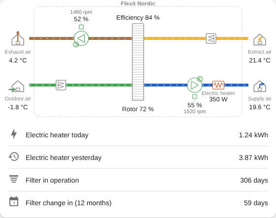
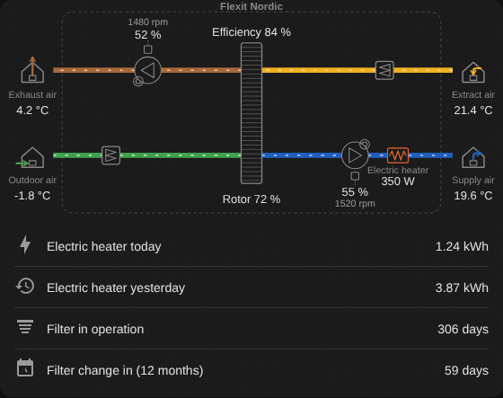

# Ventilation Card

Animated Lovelace card for ventilation units, made for **Flexit Nordic** (BACnet integration `flexit_bacnet`):
spinning fans and rotor, moving air flow, temperatures at the four house symbols, fan and rotor values,
electric heater (grey at 0 W, colored when heating), filter alarm, statistics below the card
and an optional PIN-protected settings menu. Tap any value to open its history.

Languages: **Deutsch, Norsk, English**. Light, dark or Home Assistant theme. Visual card editor included.

## Preview

| Light | Dark |
| --- | --- |
|  |  |

Still images: [light](docs/ventilation-card-light.png), [dark](docs/ventilation-card-dark.png).
The previews are rendered in a test page with sample values, not from a live Home Assistant.

## Installation (HACS)

1. HACS → three dots → **Custom repositories** → add `https://github.com/mic-chr/ventilation-card`, category **Dashboard**.
2. Install **Ventilation Card**, reload the browser.
3. Dashboard → edit → **Add card** → **Ventilation Card**, or paste:

```yaml
type: custom:ventilation-card
device_prefix: flexit_nordic
```

`device_prefix` is the part of your entity IDs after the domain, e.g. `sensor.flexit_nordic_exhaust_air_temperature` → `flexit_nordic`.
Any single entity can be overridden in the editor (section "Entities") or in YAML with `entity_temp_exhaust: sensor.my_sensor` etc.

For full width use a view of type *Panel (1 card)* or a sections view.

## Options (all optional)

| Option | Default | Meaning |
| --- | --- | --- |
| `language` | Home Assistant language | `de`, `no`, `en` |
| `theme` | `auto` | `auto`, `light`, `dark` |
| `name` | – | Title inside the picture |
| `show_temps`, `show_pct`, `show_rpm`, `show_eff`, `show_rot`, `show_heater`, `show_heater_symbol`, `show_filter_alarm`, `show_frame`, `show_flow`, `show_name` | `true` | Show or hide parts of the picture |
| `show_stats` | `true` | Rows below the picture |
| `show_days` | `true` | Filter in days and time remaining (needs `filter_months`) |
| `filter_months` | `12` | Filter change interval; remaining days = months × 730 h − operating hours |
| `entity_heater_daily_meter` | – | Daily kWh meter of the heater (resets at midnight). Enables the rows "today" and "yesterday" |
| `entity_heater_yesterday` | – | Optional separate sensor for yesterday; otherwise the `last_period` attribute of the daily meter is used |
| `font_scale` | `100` | Text size in percent |
| `fan_speed`, `rotor_speed` | `1` | Seconds per turn / per stripe cycle |
| `color_exhaust`, `color_outdoor`, `color_extract`, `color_supply`, `color_heater` | built-in | Hex colors |
| `name_*` | by language | Override labels |
| `show_menu` | `false` | PIN submenu (see below) |
| `menu_fans`, `menu_fire`, `menu_switches`, `menu_temp` | `true` | Parts of the submenu |
| `menu_custom` | – | List of your own rows `{entity, name}`; an entry without entity is a heading |

The heater power sensor may be in kW or W, the card always shows watts.

## PIN submenu

The menu shows a PIN field. When the right PIN is entered, fan levels, fireplace and cooker hood settings, switches and the
temperature setpoint appear, and lock again after a few minutes. It needs two helpers and two automations:
see [`examples/pin-menu-helpers.yaml`](examples/pin-menu-helpers.yaml). Note: the PIN only protects against accidental changes.
It is stored readable in an automation and is no security feature.

## Notes

* Filter reset is not possible from Home Assistant, the integration offers no reset entity. Reset it on the unit or in the Flexit GO app.
* Tested with the entity names of the `flexit_bacnet` integration. Other names can be mapped with `entity_*` options.

---

# Deutsch

Animierte Lovelace-Karte für **Flexit Nordic** Lüftungsgeräte: drehende Ventilatoren und Rotor, Luftstrom, Temperaturen an den vier Häuschen,
Heizregister (grau bei 0 W, farbig beim Heizen), Filter-Alarm, Statistik unter dem Bild und ein optionales Einstellungsmenü mit PIN.
Ein Tipp auf einen Wert öffnet den Verlauf. Sprachen Deutsch, Norsk, English, Hell/Dunkel, grafischer Karten-Editor.

**Installation:** HACS → Menü → *Benutzerdefinierte Repositories* → `https://github.com/mic-chr/ventilation-card`, Kategorie *Dashboard* →
installieren → Browser neu laden → Karte hinzufügen → *Ventilation Card*. Minimal reicht:

```yaml
type: custom:ventilation-card
device_prefix: flexit_nordic
language: de
```

Das PIN-Menü braucht zwei Helfer und zwei Automationen (`examples/pin-menu-helpers.yaml`). Der Filter lässt sich nicht aus Home Assistant zurücksetzen.
